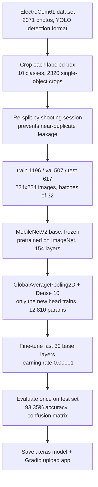

## Pipeline

### Key decisions
- **Detection to classification:** the dataset has many components per photo, so each labeled box was cropped into its own image.
- **Session-based split:** the original train/valid/test folders contained photos taken seconds apart, so photos were grouped by capture session and each group kept in one split.
- **Transfer learning:** the pretrained base was frozen and only a new 10-class output layer was trained, then the last 30 base layers were unfrozen at a low learning rate.
- **Test set used once:** all decisions were made on validation data.

### Limitations
- Classifies one component per image. It is not an object detector.
- The model always picks one of its 10 classes, even for parts it was not trained on.
- The two IC base classes are the most confused pair.
